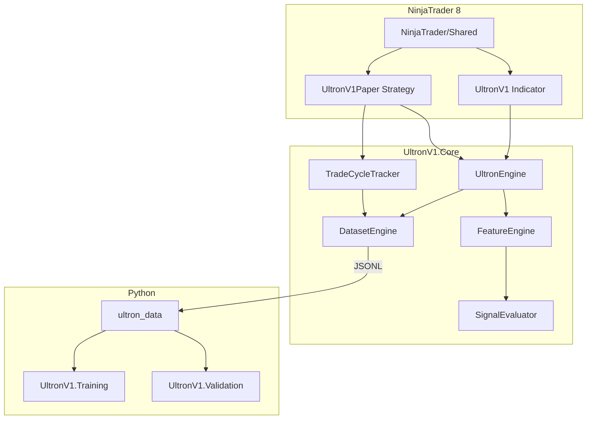

# Ultron V1 — Architecture (RC1)

**Version (documented):** `1.0.0-rc1`  
**Instrument:** MNQ 09-26 · 5-minute primary bar · On each tick  
**Status:** Release Candidate 1 — frozen architecture

Related docs: [DEPLOY.md](DEPLOY.md) · [CHANGELOG.md](CHANGELOG.md) · [RC1_CHECKLIST.md](RC1_CHECKLIST.md) · [RC1_KNOWN_LIMITATIONS.md](RC1_KNOWN_LIMITATIONS.md)

---

## Overview

Ultron V1 is an order-flow and confluence engine for MNQ futures. The design separates:

- **Core logic** (`UltronV1.Core`) — no NinjaTrader dependency; unit-testable
- **NinjaTrader 8 hosts** — Indicator (audit/dataset) and Paper Strategy (outcome collection)
- **Python pipelines** — shared data loading, ML training, quantitative validation

RC1 is a **stabilization release**: no new trading features. The goal is reproducible build, test, deploy, and Replay data collection per [Ultron Validation Protocol v1.md](Ultron%20Validation%20Protocol%20v1.md).

---

## RC1 philosophy — frozen architecture

The following must **not** change during RC1 without explicit approval:

| Area | Rule |
|------|------|
| Trading logic | No changes to entry rules, SL/TP ticks, max bars |
| Score | No weight or threshold changes |
| Hard Gates | Frozen |
| Order Flow | Algorithm frozen |
| ML | Advisory-only; no new wiring in NT8 indicator for RC1 |
| Validation Framework | Metrics, reports, and algorithms frozen |
| Dataset record semantics | Schema version 1; honest rejection metadata (S1-C1) |

**Allowed in RC1:** structural refactors, dead-code removal, tests, docs, scripts, version metadata.

---

## End-to-end flow

```
Market ticks (NT8 OnMarketData)
        │
        ▼
MnqTickProcessor          ← delta, sweep, absorption, iceberg (Core)
        │
        ▼ (bar close)
FeatureEngine             ← 40 features from bar + indicators + OF
        │
        ▼
HardGateEvaluator         ← ADX, RVOL, regime gates
        │
        ▼
SignalEvaluator           ← confluence score, tier, direction
        │                      optional: MlAdvisor (advisory boost/penalty)
        ▼
UltronSignal / Dataset    ← opportunities.jsonl (if Dataset Engine enabled)
        │
        ▼ (UltronV1Paper only)
TradeCycleTracker         ← PaperBarSim — authoritative outcomes
        │
        ▼
DatasetEngine.EnrichOutcome → outcomes.jsonl
        │
        ├──────────────────► UltronV1.Validation (compare vs NightRanger)
        └──────────────────► UltronV1.Training (LightGBM / ONNX — advisory)
```

### Mermaid (logical layers)



---

## Project structure

```
UltronV1/
├── UltronV1.Core/              # Engine, features, gates, score, dataset, execution, ML adapters
├── UltronV1.Tests/             # xUnit — organized by domain (Feature/, Integration/, Dataset/, …)
├── UltronV1.Python/
│   └── ultron_data/            # Shared loader, schema constants, JSONL helpers
├── UltronV1.Training/          # Python ML platform (train.py, ONNX export)
├── UltronV1.Validation/        # Python validation framework (validate.py, comparator, sweep)
├── NinjaTrader/
│   ├── UltronV1.cs             # Indicator — diagnostics, HUD, optional dataset
│   ├── UltronV1Paper.cs        # Strategy — PaperBarSim + outcomes
│   ├── UltronComparisonTracker.cs  # Optional NR comparison (indicator only)
│   └── Shared/                 # VWAP, indicators bundle, tick feed, NT logger
├── tools/ExportFeatureSchema/  # CLI — exports schema JSON from FeatureSchema.cs
├── schema/                     # Committed feature_names.json + full schema
├── scripts/                    # build.ps1, test_all.ps1, test_python.ps1
└── UltronV1.sln                # Core + Tests (ExportFeatureSchema not in solution)
```

### UltronV1.Tests layout (Sprint 3)

| Folder | Scope |
|--------|--------|
| `Feature/` | FeatureEngine golden scenarios |
| `Integration/` | Engine → Dataset → TradeCycle → EnrichOutcome |
| `Dataset/` | DatasetEngine, RecordBuilder, edge cases |
| `OrderFlow/`, `Gates/`, `Scoring/`, `Ml/`, … | Domain unit tests |

**Totals (RC1):** 80 C# tests · 18 Python tests · **98 combined**

---

## Dependencies

| Component | Depends on | Notes |
|-----------|------------|-------|
| `UltronV1.Core` | — | netstandard2.0; ONNX runtime referenced for MlAdvisor |
| `UltronV1.Tests` | Core | net8.0 |
| `NinjaTrader/*` | Core.dll | NT8 host; references `UltronV1.Core.dll` |
| `NinjaTrader/Shared` | Core (indirect) | Used by Indicator + Paper |
| `ultron_data` | `schema/feature_names.json` | pip editable install |
| `UltronV1.Training` | ultron_data | `pip install -r requirements.txt` |
| `UltronV1.Validation` | ultron_data | Same shared package |
| `ExportFeatureSchema` | Core | Standalone tool project |

**Dependency direction:** Core is the single source of truth. Python never modifies Core behavior — it reads exported datasets and schema.

---

## FeatureSchema pipeline

Single source of truth: `UltronV1.Core/Features/FeatureSchema.cs` (40 features, fixed order).

```
FeatureSchema.cs
       │
       ▼
tools/ExportFeatureSchema  (dotnet run)
       │
       ├── UltronV1.Core/Features/ultron_mnq_feature_schema_v1.json
       ├── schema/ultron_mnq_feature_schema_v1.json
       └── schema/feature_names.json
       │
       ▼
ultron_data/constants.py   (reads feature_names.json at import)
       │
       ├── UltronV1.Training
       └── UltronV1.Validation
```

Automated in [`scripts/build.ps1`](scripts/build.ps1) as **step 1**, followed by `git diff --exit-code schema/` to detect uncommitted drift.

---

## Dataset pipeline

**Root (NT8 runtime):**

```
Documents/NinjaTrader 8/UltronV1/dataset/sessions/{sessionId}/
├── manifest.json
├── opportunities.jsonl    # one row per bar evaluation (features, gates, decision)
└── outcomes.jsonl         # linked by signalId (PaperBarSim only)
```

**Flow:**

1. `DatasetEngine.StartSession` — creates session + manifest
2. `UltronEngine.ProcessBarClose` → `DatasetEngine.RecordEvaluation` — appends opportunity
3. `UltronV1Paper` → `TradeCycleTracker` simulates trade on accepted signal
4. `DatasetEngine.EnrichOutcome` — appends outcome row; increments manifest

Version fields embedded in every record: `ultronVersion`, `featureSchema`, `score`, `scoreProfileHash`, `configVersion` (see S1-C3).

Details: [Fase5-OutcomeCollection.md](Fase5-OutcomeCollection.md)

---

## Test pipeline

| Script | Steps |
|--------|--------|
| [`scripts/build.ps1`](scripts/build.ps1) | ExportFeatureSchema → `dotnet build` → `dotnet test` → pytest → schema drift check |
| [`scripts/test_all.ps1`](scripts/test_all.ps1) | `dotnet test` → [`test_python.ps1`](scripts/test_python.ps1) |
| [`scripts/test_python.ps1`](scripts/test_python.ps1) | pip install (ultron_data, Training, Validation, dev) → pytest |

Python tests call Validation pipeline **in-memory** (no subprocess CLI) for determinism.

---

## RC2-only evolution (not in RC1)

See [RC1_KNOWN_LIMITATIONS.md](RC1_KNOWN_LIMITATIONS.md). Summary:

- Footprint disable / removal
- OutcomeLinked persistence in JSONL
- Outcome deduplication
- `deploy_nt8.ps1` automation
- ML wiring in NT8 indicator
- Performance tuning (lazy BuildState, manifest batching)
- RuleRegistry / UltronConfig split

---

*Architecture doc aligned with branch `feature/rc1-sprint4` @ `ca4aade`.*
