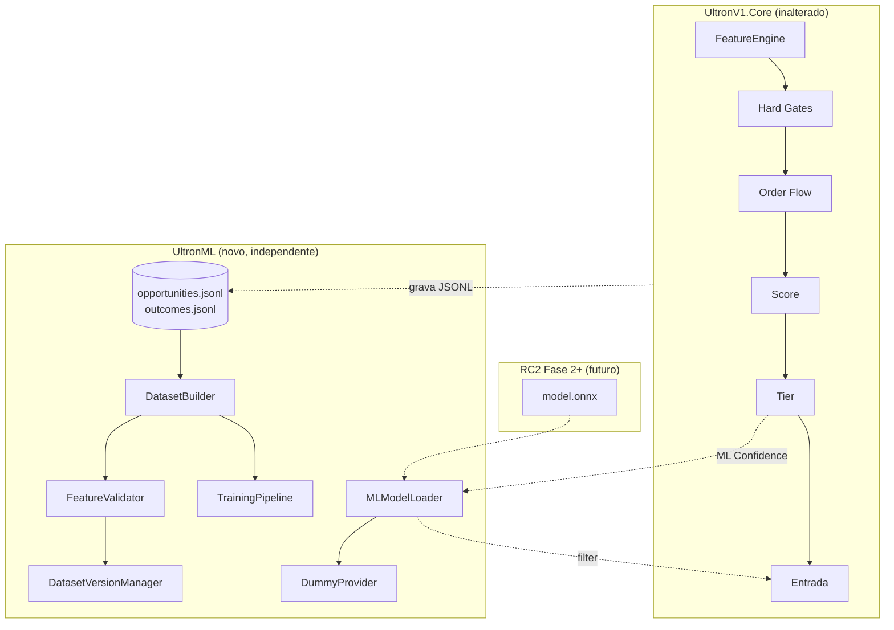

# RC2 — Machine Learning Infrastructure (Fase 1)

**Data:** 2026-06-25  
**Escopo:** Infraestrutura ML apenas — **sem treinamento**, **sem alteração operacional do Core**.

---

## Confirmações explícitas

| Afirmação | Status |
|-----------|--------|
| Nenhuma lógica operacional do Ultron foi alterada | **Confirmado** |
| `SignalEvaluator`, `UltronEngine`, `FeatureEngine`, `TradeCycleTracker`, `PaperBarSim`, ATM, Score, Gates, Order Flow, Stops, Targets e regras de entrada permanecem intocados | **Confirmado** |
| `UltronV1.Core` **não** referencia `UltronML` | **Confirmado** (grep sem matches) |
| Com `EnableMlFilter = false`, comportamento idêntico ao RC1 | **Confirmado** (`MLModelLoader` retorna `PassThrough` com confidence 1.0) |
| Nenhum modelo foi treinado nesta fase | **Confirmado** |

---

## 1. Arquivos criados

### Python — `UltronML/`

| Arquivo | Função |
|---------|--------|
| `pyproject.toml` | Pacote `ultronml`, CLI `ultronml-export` |
| `README.md` | Guia rápido do pacote |
| `ultronml/__init__.py` | Versão do pacote |
| `ultronml/config.py` | `MlFilterConfig` Python (`enable_ml_filter=False`) |
| `ultronml/constants.py` | `FEATURE_NAMES`, `LABEL_COLUMNS`, versões de schema |
| `ultronml/io/jsonl.py` | Leitor JSONL |
| `ultronml/dataset/builder.py` | **DatasetBuilder** — join opportunities + outcomes |
| `ultronml/dataset/versioning.py` | **DatasetVersionManager** — parquet + metadata |
| `ultronml/features/metadata.py` | **FeatureMetadataRegistry** |
| `ultronml/features/validator.py` | **FeatureValidator** |
| `ultronml/training/pipeline.py` | **TrainingPipeline** (stub, sem train) |
| `ultronml/benchmark/runner.py` | **MlBenchmarkRunner** |
| `ultronml/importance/schema.py` | Esquema de feature importance |
| `ultronml/cli/export_dataset.py` | CLI de exportação |
| `tests/test_infrastructure.py` | Testes pytest (3 passed) |
| `datasets/README.md` | Convenção de versionamento |
| `docs/RC2_ML_ARCHITECTURE.md` | Documentação de arquitetura |

### C# — `UltronML/UltronML.Core/`

| Arquivo | Função |
|---------|--------|
| `UltronML.Core.csproj` | netstandard2.0, independente do Core |
| `IMLProvider.cs` | Contrato Load / Predict / Unload |
| `MlFilterConfig.cs` | `EnableMlFilter` default **false** |
| `MlPredictionInput.cs` / `MlPredictionResult.cs` | DTOs de inferência |
| `Providers/DummyProvider.cs` | Confidence **1.0** sempre |
| `Providers/OnnxProviderStub.cs` | Placeholder futuro ONNX |
| `MLModelLoader.cs` | Carrega, valida artefatos, despacha provider |
| `Importance/FeatureImportanceReport.cs` | Formato de importance (sem cálculo) |

### C# — Testes

| Arquivo | Função |
|---------|--------|
| `UltronML.Tests/UltronML.Tests.csproj` | Projeto xUnit |
| `UltronML.Tests/DummyProviderTests.cs` | 3 testes (todos passando) |

### Modelos (placeholders)

| Arquivo | Função |
|---------|--------|
| `models/README.md` | Layout esperado |
| `models/version.json` | Placeholder |
| `models/metadata.json` | Placeholder |
| `models/feature_list.json` | Placeholder |

---

## 2. Arquivos modificados

| Arquivo | Alteração |
|---------|-----------|
| `UltronV1.sln` | Adicionados projetos `UltronML.Core` e `UltronML.Tests` |

**Nenhum arquivo em `UltronV1.Core/`, `NinjaTrader/`, `SignalEvaluator`, engine ou paper foi modificado para RC2.**

---

## 3. Arquitetura



### Princípios

1. **ML = filtro de confiança**, nunca decisor autônomo.
2. **Core não depende de UltronML** — integração futura será no host NinjaTrader.
3. **Features de inferência** = snapshot pré-entrada; **labels** = MFE/MAE/PnL/outcome.
4. **DummyProvider** garante RC1 quando filtro desligado ou modelo ausente.

---

## 4. Fluxograma operacional (futuro)

```
Features
  → Hard Gates
  → Order Flow
  → Score
  → Tier
  → ML Confidence   ← MLModelLoader.Predict()
  → Entrada         ← só se confidence >= MinConfidence
```

**Exemplos (futuro, com modelo real):**

| Score | Tier | ML Confidence | Ação |
|-------|------|---------------|------|
| 71 | A | 84% | Entrar |
| 72 | A | 41% | Não entrar |

**Hoje (Fase 1):** filtro não está ligado ao engine; `DummyProvider` retorna 1.0.

---

## 5. Estrutura dos datasets

### Origem

```
dataset/
  sessions/
    {session-id}/
      opportunities.jsonl   ← features + score + gates (pré-entrada)
      outcomes.jsonl        ← MFE, MAE, PnL, bars (labels)
```

### Exportação

```
UltronML/datasets/
  dataset_v1.parquet
  dataset_v2.parquet
  metadata.json           ← histórico por versão
  feature_metadata.json   ← gerado pelo TrainingPipeline
```

### Colunas principais (tabular)

| Grupo | Colunas |
|-------|---------|
| Identidade | `trade_id`, `session`, `timestamp_utc`, `date`, `time`, `instrument`, `direction` |
| Sinal | `score`, `tier`, `archetype`, `regime`, `decision` |
| Features (40) | `feat_Delta`, `feat_Sweep`, `feat_Rsi`, `feat_Adx`, … (`feat_*`) |
| Gates | `gate_{name}_long`, `gate_{name}_short`, `gates_*` |
| Score breakdown | `score_contrib_*`, `score_applied_*` |
| Order flow | `order_flow_passed`, `order_flow_reason` |
| Tempo | `hour`, `minute`, `day_of_week` |
| **Labels** | `mfe_ticks`, `mae_ticks`, `realized_pnl_ticks`, `bars_in_trade`, `is_win`, `is_loss`, `is_breakeven`, `label` |

### metadata.json (por versão)

```json
{
  "dataset_v1": {
    "version": "dataset_v1",
    "createdAtUtc": "...",
    "gitCommit": "abc1234",
    "tradeCount": 868,
    "winCount": 412,
    "lossCount": 456,
    "features": ["feat_Delta", "..."],
    "labels": ["mfe_ticks", "..."],
    "validationPassed": true
  }
}
```

---

## 6. Formato dos modelos (futuro)

```
models/
  model.onnx              # pesos exportados (Fase 2+)
  metadata.json           # algoritmo, métricas, data de treino
  feature_list.json       # ordem exata das features para inferência
  version.json            # versão do modelo + compatibilidade de schema
```

`MLModelLoader` valida presença de `version.json` e feature list antes de carregar provider real.

---

## 7. Compatibilidade com RC1

| Aspecto | RC1 | RC2 Fase 1 |
|---------|-----|------------|
| Engine / gates / score | Ativo | **Idêntico** |
| Dataset | JSONL manual | + export parquet opcional |
| ML em runtime | `IMlAdvisor` (boost advisory, Phase 4) | `IMLProvider` separado em UltronML |
| Filtro ML | N/A | Infra pronta, **desligado** |
| Confidence default | N/A | **1.0** (pass-through) |

O `IMlAdvisor` existente em `UltronV1.Core/Ml/` **não foi alterado** e é independente do novo `IMLProvider`.

---

## 8. Como migrar para RC2

### Fase 1 (concluída — infra apenas)

```powershell
cd UltronV1\UltronML
pip install -e ".[dev]"
ultronml-export --dataset-root "C:\...\UltronV1\dataset"
dotnet build UltronML\UltronML.Core\UltronML.Core.csproj
```

### Fase 2 (futura — integração runtime)

1. Referenciar `UltronML.Core` apenas no projeto **NinjaTrader** (não no Core).
2. Após `Tier` aprovado, chamar `MLModelLoader.Predict()`.
3. Bloquear entrada se `confidence < MinConfidence`.
4. Manter `EnableMlFilter=false` até modelo validado em paper.

### Fase 3 (futura — treino)

1. Acumular milhares de trades via JSONL existente.
2. Exportar `dataset_vN.parquet`.
3. Treinar XGBoost/LightGBM **fora do NinjaTrader**.
4. Exportar ONNX → `models/`.
5. Implementar `OnnxProvider` (substituir stub).
6. Ativar `EnableMlFilter=true`.

---

## 9. Checklist — integração XGBoost / ONNX

- [ ] Dataset com ≥ N trades exportado e validado (`validationPassed: true`)
- [ ] `feature_list.json` alinhado com `schema/feature_names.json` (40 features)
- [ ] Treino offline com split temporal (não aleatório por trade)
- [ ] Métricas: AUC, calibration, precision@threshold
- [ ] Export ONNX com opset compatível NT8 / .NET
- [ ] Implementar `OnnxProvider` em `UltronML.Core`
- [ ] Registrar provider em `MLModelLoader.ResolveProvider`
- [ ] Benchmark inferência < 5 ms (target)
- [ ] Testes com `EnableMlFilter=true` em paper antes de live
- [ ] Documentar threshold `MinConfidence` por tier
- [ ] Rollback: `EnableMlFilter=false` restaura RC1 instantaneamente

---

## 10. Componentes por requisito

| # | Requisito | Entrega |
|---|-----------|---------|
| 1 | Projeto UltronML independente | `UltronML/` Python + `UltronML.Core` C# |
| 2 | DatasetBuilder | `ultronml/dataset/builder.py` |
| 3 | Dataset versioning | `ultronml/dataset/versioning.py` |
| 4 | Feature metadata | `ultronml/features/metadata.py` |
| 5 | Feature validator | `ultronml/features/validator.py` |
| 6 | Training pipeline offline (sem train) | `ultronml/training/pipeline.py` |
| 7 | Diretório `models/` | `UltronML/models/` |
| 8 | MLModelLoader | `UltronML.Core/MLModelLoader.cs` |
| 9 | IMLProvider | `UltronML.Core/IMLProvider.cs` |
| 10 | DummyProvider | `UltronML.Core/Providers/DummyProvider.cs` |
| 11 | Enable ML Filter (default false) | `MlFilterConfig` C# + Python |
| 12 | Feature importance (estrutura) | `importance/schema.py` + `FeatureImportanceReport.cs` |
| 13 | Benchmark | `ultronml/benchmark/runner.py` |
| 14 | Documentação | `docs/RC2_ML_ARCHITECTURE.md` + este relatório |

---

## 11. Testes executados

| Suite | Resultado |
|-------|-----------|
| `pytest UltronML/tests` | **3 passed** |
| `dotnet test UltronML.Tests` | **3 passed** |
| `dotnet build UltronML.Core` | **0 erros** |

---

## 12. O que NÃO foi implementado (conforme pedido)

- Treino XGBoost / LightGBM / CatBoost
- Rede neural
- Integração do filtro ML no `SignalEvaluator` / `UltronEngine`
- Alteração de entradas, score, gates ou stops
- ML decidindo trades sozinho

---

## 13. Pontos de extensão

| Extensão | Onde |
|----------|------|
| Novo provider | Implementar `IMLProvider`, registrar em `MLModelLoader` |
| Nova feature | `schema/feature_names.json` + `FeatureMetadataRegistry` |
| Novo algoritmo de treino | `TrainingPipeline.run()` — adicionar stage após `export_parquet` |
| Novo formato de dataset | Incrementar `DATASET_SCHEMA_VERSION` em `constants.py` |
| Threshold por tier | `MlFilterConfig` — estender em Fase 2 |

---

*RC2 Fase 1 concluída. Próximo passo recomendado: exportar dataset real das 12+ sessões NT8 e validar parquet antes de qualquer treino.*
