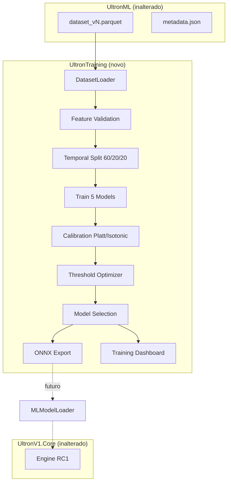

# RC2 — Phase 3 — Machine Learning Training Pipeline

**Data:** 2026-06-25  
**Escopo:** Primeiro treinamento real de modelos — **100% offline**, **sem integração NinjaTrader**.

---

## Confirmações explícitas

| Afirmação | Status |
|-----------|--------|
| Nenhuma regra operacional foi alterada | **Confirmado** |
| `UltronEngine`, `SignalEvaluator`, `FeatureEngine`, gates, score, stops, targets **não modificados** | **Confirmado** |
| Todo treinamento ocorre offline | **Confirmado** |
| Ultron continua idêntico ao RC1 em runtime | **Confirmado** |
| Próximo passo = integrar modelo exportado ao `MLModelLoader` | **Confirmado** (não feito nesta fase) |
| Nenhum modelo integrado ao NinjaTrader | **Confirmado** |

---

## 1. Arquitetura



### Direção de dependências

```
UltronCore        →  sem dependência de Training
UltronML          →  sem dependência de Training
UltronResearch    →  sem dependência de Training
UltronTraining    →  lê apenas parquet exportado pelo UltronML
```

---

## 2. Fluxograma do pipeline

```
Dataset (parquet)
  ↓
Feature Validation
  ↓
Temporal Split (60% Train / 20% Val / 20% Test)
  ↓
Train (Logistic, RF, XGBoost, LightGBM, CatBoost)
  ↓
Validation Metrics
  ↓
Calibration (Platt vs Isotonic → melhor)
  ↓
Test Metrics + Threshold Grid (0.50–0.95)
  ↓
Walk Forward (Expanding + Rolling)
  ↓
SHAP Analysis
  ↓
Model Comparison → Champion
  ↓
ONNX Export + Artifacts + Dashboard
```

---

## 3. Modelos treinados

| Modelo | Classe | Extensível |
|--------|--------|------------|
| Logistic Regression | `LogisticTrainer` | via `BaseTrainer` |
| Random Forest | `RandomForestTrainer` | via `BaseTrainer` |
| XGBoost | `XGBoostTrainer` | via `BaseTrainer` |
| LightGBM | `LightGBMTrainer` | via `BaseTrainer` |
| CatBoost | `CatBoostTrainer` | via `BaseTrainer` |

**Target:** `is_win` → probabilidade de trade vencedor.  
**Não prevê:** direção BUY/SELL (permanece no engine Ultron).

---

## 4. Split temporal

- **Proibido:** random shuffle
- **Obrigatório:** ordenação por `timestamp_utc`
- **Padrão:** 60% train / 20% validation / 20% test

### Walk Forward

| Modo | Implementação |
|------|---------------|
| Expanding Window | `walk_forward_expanding()` |
| Rolling Window | `walk_forward_rolling()` |

Ambos comparados por modelo nos artefatos de treino.

---

## 5. Métricas calculadas

### Classificação
- ROC AUC · PR AUC · Precision · Recall · F1 · Accuracy
- Log Loss · Brier Score · Calibration Error (ECE)
- Confusion Matrix

### Trading (por threshold)
- Win Rate · Profit Factor · Expectancy · Trades · Drawdown

---

## 6. Calibração

| Método | Implementação |
|--------|---------------|
| Platt Scaling | `LogisticRegression` sobre probabilidades |
| Isotonic Regression | `IsotonicRegression` |

Seleção automática pelo menor `brier_score + calibration_error`.

Exportado em `calibration.json`.

---

## 7. Threshold Optimizer

Grid padrão: `0.50, 0.55, …, 0.95`

Para cada threshold:
- Win Rate, PF, Expectancy, Trades, Drawdown

Ótimo selecionado por PF (fallback: Expectancy).

Exportado em `thresholds.json`.

---

## 8. SHAP

Por modelo campeão e demais:
- Global Feature Importance (mean |SHAP|)
- Top 20 / Bottom 10 features
- Local explanations (amostra)
- Summary plot + Dependence plot (`shap/{model}/`)

---

## 9. Comparação e campeão

Tabela automática:

| Coluna | Descrição |
|--------|-----------|
| model | Nome |
| roc_auc | Validação |
| pr_auc | Validação |
| profit_factor | Test @ threshold ótimo |
| expectancy | Test |
| calibration_error | Pós-calibração |
| train_time_ms | Benchmark |
| infer_time_ms | Benchmark |
| model_size_kb | Tamanho |

**Seleção:** composite = 50% ROC-AUC + 30% PF + 20% calibração.

---

## 10. Exportação (formato)

```
trained_models/
  champion/
    model.onnx
    metadata.json
    feature_list.json
    training_report.json
    thresholds.json
    calibration.json
    metrics.json
    version.json
  dashboard/
    index.html
  shap/
    {ModelName}/
      shap_summary.png
      shap_dependence.png
```

### metadata.json

```json
{
  "model": "LightGBM",
  "task": "win_probability",
  "description": "P(win) — confidence filter only",
  "datasetVersion": "dataset_v1",
  "phase": "RC2-Phase3",
  "integration": "MLModelLoader.OnnxProvider (future)"
}
```

### feature_list.json

```json
{
  "features": ["feat_Delta", "feat_Rsi", "score", "tier", "..."],
  "count": 48,
  "order": "column_order_for_inference"
}
```

### ONNX

- Opset 12
- Input: `float32[N, feature_count]`
- Output: probabilidades (classe 1 = win)
- CatBoost: export nativo; demais via `skl2onnx` / `onnxmltools`

---

## 11. Estrutura de diretórios

```
UltronTraining/
├── pyproject.toml
├── README.md
├── tests/
└── ultrontraining/
    ├── config.py
    ├── data/           loader, features
    ├── split/          temporal, walk_forward
    ├── models/         5 trainers + adapter
    ├── metrics/        classification
    ├── calibration/    platt, isotonic
    ├── optimization/   threshold
    ├── explain/        shap
    ├── export/         onnx, artifacts
    ├── comparison/     champion selection
    ├── dashboard/      HTML
    ├── pipeline/       orchestrator
    └── cli/            ultrontrain
```

---

## 12. Como executar

```powershell
cd UltronV1\UltronML
ultronml-export --dataset-root "..\dataset" --output-dir datasets

cd ..\UltronTraining
pip install -e ".[dev]"
ultrontrain --datasets-dir ..\UltronML\datasets --output-dir trained_models
```

Opções:
- `--models LogisticRegression,XGBoost` — subconjunto
- `--no-shap` — desabilita SHAP
- `--no-walk-forward` — desabilita WF

---

## 13. Testes

| Suite | Resultado |
|-------|-----------|
| `pytest UltronTraining/tests` | **3 passed** |

---

## 14. Checklist — integração futura (Fase 4)

- [ ] Copiar `trained_models/champion/` → `UltronML/models/`
- [ ] Implementar `OnnxProvider` em `UltronML.Core`
- [ ] Registrar provider em `MLModelLoader.ResolveProvider`
- [ ] Validar `feature_list.json` vs ordem de inferência no host
- [ ] Aplicar `thresholds.json` → `MlFilterConfig.MinConfidence`
- [ ] Referenciar `UltronML.Core` apenas no projeto NinjaTrader
- [ ] Chamar `Predict()` após Tier — **não** substituir engine
- [ ] `EnableMlFilter=false` → rollback instantâneo ao RC1
- [ ] Paper trading com filtro ativo antes de live

---

## 15. Arquivos criados vs modificados

### Criados
- Todo o diretório `UltronTraining/` (~25 arquivos Python)

### Modificados
- **Nenhum** arquivo em `UltronV1.Core`, `UltronML.Core`, `NinjaTrader`, engine ou paper

---

## 16. Compatibilidade RC1

| Componente | RC1 | Phase 3 |
|------------|-----|---------|
| Engine / entradas | Ativo | **Inalterado** |
| `DummyProvider` | Confidence 1.0 | **Inalterado** |
| `EnableMlFilter` | false | **Inalterado** |
| Modelo em produção | N/A | Exportado offline apenas |

---

*RC2 Phase 3 concluída. O modelo está pronto para exportação; a integração ao `MLModelLoader` é o próximo passo explícito.*
