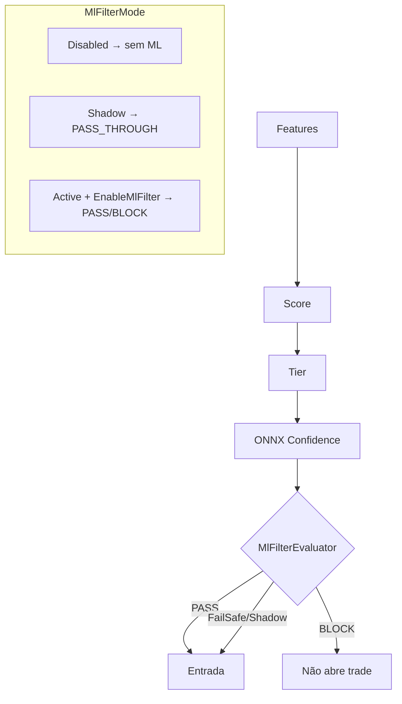

# RC2 — Phase 4B — Safe ML Filter

**Data:** 2026-06-25  
**Escopo:** ML pode **vetar** entradas — nunca criar operações.

---

## Confirmações explícitas

| Afirmação | Status |
|-----------|--------|
| O ML nunca cria operações | **Confirmado** |
| O ML apenas veta operações (modo Active) | **Confirmado** |
| RC1 idêntico quando filtro desativado | **Confirmado** (`MlFilterMode=Disabled`, defaults) |
| Todo erro ML → PASS automático (FailSafe) | **Confirmado** (`!prediction.Active`) |
| Rollback imediato via `ForcePassThrough` ou `MlFilterMode=Shadow` | **Confirmado** |
| Engine, SignalEvaluator, FeatureEngine, gates, score, tier **não modificados** | **Confirmado** |

---

## 1. Arquitetura



### Regra principal

```
Ultron → BUY/SELL → ML → PASS ou BLOCK
```

Nunca: `ML → BUY`

---

## 2. Sequência de decisão

```
1. UltronEngine gera sinal (inalterado)
2. UltronV1Paper: tier >= MinTierForEntry (inalterado)
3. UltronMlHost.EvaluateEntry()
   a. ONNX Predict → confidence
   b. MlFilterEvaluator.Evaluate()
4. Se AllowEntry=false → return (sem TryOpen)
5. Se AllowEntry=true → TradeCycleTracker.TryOpen (inalterado)
```

---

## 3. Configuração

| Propriedade | Default | Grupo |
|-------------|---------|-------|
| `MlFilterMode` | **Disabled** | ML Filter |
| `EnableMlFilter` | **false** | ML Filter |
| `EnableShadowMl` | false | Shadow ML |
| `ForcePassThrough` | false | ML Filter |
| `MlUseAutoThreshold` | true | ML Filter |
| `MlThresholdManual` | 0.70 | ML Filter |

### MlFilterMode

| Modo | Comportamento |
|------|---------------|
| **Disabled** | Ultron puro (RC1) |
| **Shadow** | Entra normalmente + ML observa + `PASS_THROUGH` |
| **Active** | ML pode bloquear se `EnableMlFilter=true` |

### Threshold

- **Auto:** `thresholds.json` do modelo
- **Manual:** 0.40–0.95 via `MlThresholdManual`

---

## 4. Logs `[ML FILTER]`

```
[ML FILTER]
TradeId=session-...
Score=73
Tier=A
Confidence=0.8100
Threshold=0.70
Decision=PASS
Reason=ConfidenceMet
```

Bloqueio:

```
Decision=BLOCK
Reason=LowConfidence
```

FailSafe:

```
Decision=PASS
Reason=FailSafe
```

---

## 5. Segurança / FailSafe

| Condição | Resultado |
|----------|-----------|
| Modelo ausente | PASS (FailSafe) |
| Erro ONNX | PASS |
| Features incompatíveis | PASS |
| Threshold inválido | fallback 0.50 |
| `ForcePassThrough=true` | PASS sempre |

**Nunca bloqueia em erro.**

---

## 6. Rollback

| Método | Efeito |
|--------|--------|
| `ForcePassThrough=true` | Todos passam instantaneamente |
| `MlFilterMode=Shadow` | Observa, nunca bloqueia |
| `MlFilterMode=Disabled` | RC1 puro |
| `EnableMlFilter=false` | Active não bloqueia |

---

## 7. Estatísticas (runtime)

`MlFilterStatistics` — log ao encerrar sessão:

- TradesPassed / TradesBlocked
- Passed Win Rate / PF / Expectancy
- FailSafePasses
- Filter precision (true vs false blocks, quando outcome disponível)

---

## 8. shadow_predictions.jsonl (estendido)

Novos campos:

- `filterMode`, `filterReason`, `entryAllowed`, `wouldBlockInActive`

---

## 9. ML Filter Dashboard

```powershell
ultronresearch-filter --shadow-file "...\shadow_predictions.jsonl" --output-dir research_output
```

Mostra:

- PASS × BLOCK (WR, PF, Expectancy, DD, MFE, MAE)
- Shadow comparison
- False blocks / True blocks / Precision
- Improvement vs all trades
- Threshold optimizer (counterfactual)
- Calibration / Brier

---

## 10. Arquivos alterados

### UltronML.Core
- `MlFilterMode.cs`, `MlHostConfig.cs`, `MlFilterEvaluator.cs`
- `MlFilterResult.cs`, `MlFilterStatistics.cs`
- `ShadowMlService.cs` (MlHostConfig)
- `MlDecision.cs` (+ PASS, BLOCK)

### NinjaTrader
- `UltronMlHost.cs` (substitui fluxo shadow-only)
- `UltronMlFilterMode.cs`
- `UltronShadowPredictionSink.cs` (campos filter)
- `UltronV1Paper.cs` (gate antes de TryOpen)

### UltronResearch
- `filter/analysis.py`, `filter/dashboard.py`
- `cli/run_filter.py`

### Não alterados
- `UltronV1.Core/**` (engine, evaluator, feature engine, paper bar sim)

---

## 11. Ativação segura (recomendado)

1. **Fase observação:** `MlFilterMode=Shadow` — acumular dados
2. **Análise:** `ultronresearch-filter` — validar precision / false blocks
3. **Ativação:** `MlFilterMode=Active` + `EnableMlFilter=true`
4. **Rollback:** `ForcePassThrough=true` se necessário

---

## 12. Testes

| Suite | Resultado |
|-------|-----------|
| `UltronML.Tests` (incl. MlFilterEvaluator) | **11 passed** |
| `UltronResearch test_filter` | **1 passed** |

---

## 13. Checklist pós-deploy

- [ ] Champion model em `UltronML/models/champion/`
- [ ] Shadow mode 1–2 semanas
- [ ] Dashboard: false blocks < aceitável
- [ ] Latência P99 OK
- [ ] Ativar Active + EnableMlFilter
- [ ] Manter `ForcePassThrough` acessível
- [ ] Monitorar `[ML FILTER] Stats` por sessão

---

*RC2 Phase 4B concluída. O Ultron decide; o ML apenas pode vetar em modo Active.*
