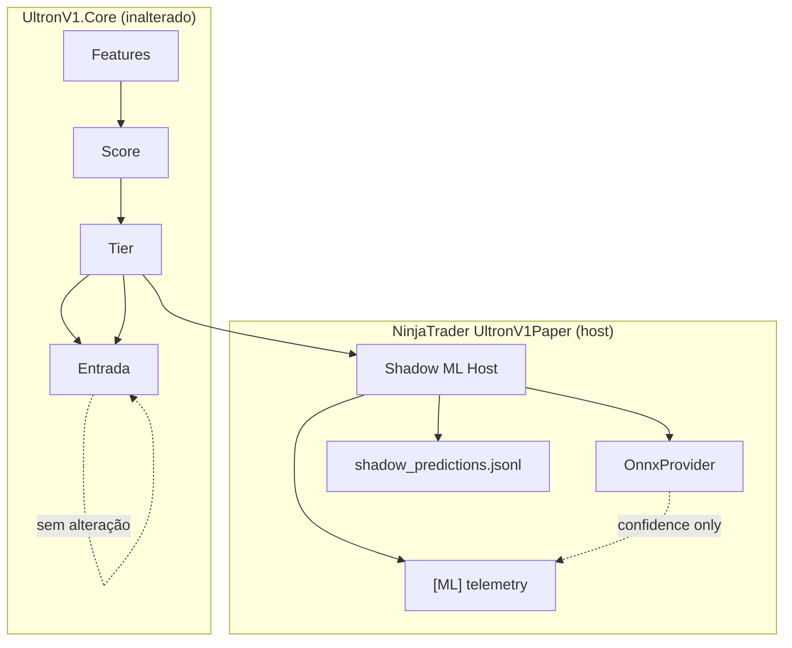

# RC2 — Phase 4A — Shadow ML Integration

**Data:** 2026-06-25  
**Escopo:** Integração ONNX em modo **Shadow** — ML observa, **nunca bloqueia** trades.

---

## Confirmações explícitas

| Afirmação | Status |
|-----------|--------|
| Nenhuma regra operacional foi alterada | **Confirmado** |
| `SignalEvaluator`, `UltronEngine`, `FeatureEngine`, `TradeCycleTracker`, `PaperBarSim`, gates, score, stops, targets, order flow **não modificados** | **Confirmado** |
| O ML apenas observa (Shadow) | **Confirmado** |
| Todo trade continua sendo executado | **Confirmado** |
| `EnableMlFilter` permanece **false** por padrão | **Confirmado** |
| `EnableShadowMl` padrão **false** → RC1 idêntico | **Confirmado** |
| Decision sempre **PASS_THROUGH** — nunca BLOCK | **Confirmado** |
| Erro ONNX → Confidence **1.0**, operação continua | **Confirmado** |
| Próximo passo: Fase 4B ativar filtro após validação estatística | Documentado |

---

## 1. Fluxograma



**Com Shadow desligado:** fluxo RC1 puro (sem ramo ML).

---

## 2. Arquivos alterados

### UltronML.Core (novo / atualizado)

| Arquivo | Função |
|---------|--------|
| `Providers/OnnxProvider.cs` | Inferência ONNX real |
| `ModelArtifacts.cs` | Carrega metadata, feature_list, thresholds, calibration |
| `ShadowMlConfig.cs` | `EnableShadowMl`, `EnableMlFilter=false` |
| `ShadowMlService.cs` | Runner shadow — sempre PASS_THROUGH |
| `MlDecision.cs` | Constantes PASS_THROUGH / BLOCK |
| `MlPredictionResult.cs` | +LatencyMs, Threshold, Decision |
| `MLModelLoader.cs` | Registro OnnxProvider (só quando filter ativo) |
| `UltronML.Core.csproj` | +OnnxRuntime, System.Text.Json |

### NinjaTrader (camada host — sem tocar no Core)

| Arquivo | Função |
|---------|--------|
| `Shared/UltronShadowMlHost.cs` | Adapter shadow + latência |
| `Shared/UltronShadowFeatureBuilder.cs` | Monta vetor ONNX a partir do sinal |
| `Shared/UltronShadowPredictionSink.cs` | Escreve `shadow_predictions.jsonl` |
| `UltronV1Paper.cs` | Props Shadow ML + hook observacional |

### UltronResearch (dashboard shadow)

| Arquivo | Função |
|---------|--------|
| `shadow/analysis.py` | Confidence×WR/PF, calibration, threshold study |
| `shadow/dashboard.py` | Shadow Dashboard HTML |
| `cli/run_shadow.py` | CLI `ultronresearch-shadow` |

### Não alterados

- `UltronV1.Core/**` (engine, evaluator, feature engine, paper bar sim, gates, score)
- `DatasetBuilder`, regras de entrada

---

## 3. Integração ONNX

### Local do modelo

```
Documents/NinjaTrader 8/UltronV1/UltronML/models/champion/
  model.onnx
  metadata.json
  feature_list.json
  thresholds.json
  calibration.json
  version.json
```

Copiar de `UltronTraining/trained_models/champion/` após treino offline.

### OnnxProvider

- Carrega `model.onnx` via Microsoft.ML.OnnxRuntime
- Valida contagem de features vs `feature_list.json`
- Output: probabilidade classe **win** (índice 1)
- Falha → Confidence **1.0**, Reason logado

### Formato de inferência

| Campo | Tipo | Descrição |
|-------|------|-----------|
| Input | `float[1, N]` | N = features em `feature_list.json` |
| Output | `float` | P(win) ∈ [0, 1] |
| Opset | 12 | Compatível export UltronTraining |

---

## 4. Telemetria `[ML]`

Exemplo no Output Window:

```
[ML]
Model Version=1.0.0
Confidence=0.8200
Latency=1.45ms
Threshold=0.55
Decision=PASS_THROUGH
```

Ao encerrar sessão:

```
[ML] Latency summary avg=1.32ms max=4.10ms p95=2.80ms p99=3.50ms n=42
```

---

## 5. shadow_predictions.jsonl

**Local:** `{dataset}/sessions/{sessionId}/shadow_predictions.jsonl`

**Uma linha por trade** (escrita ao fechar o outcome):

```json
{
  "tradeId": "session-20260601-...",
  "timestampUtc": "2026-06-01T14:30:00.0000000Z",
  "score": 71,
  "tier": "A",
  "direction": "Long",
  "confidence": 0.82,
  "threshold": 0.55,
  "modelVersion": "1.0.0",
  "inferenceTimeMs": 1.45,
  "decision": "PASS_THROUGH",
  "atm": "PaperBarSim",
  "outcomeRecorded": true,
  "win": true,
  "loss": false,
  "mfeTicks": 20.0,
  "maeTicks": 5.0,
  "pnlTicks": 32.0,
  "features": [0.12, 0.45, ...]
}
```

---

## 6. Configuração NinjaTrader

| Propriedade | Grupo | Default |
|-------------|-------|---------|
| `EnableShadowMl` | Shadow ML | **false** |
| `ShadowMlModelDirectory` | Shadow ML | vazio → `UltronV1/UltronML/models/champion` |
| `EnableMlFilter` | (UltronML) | **false** — inalterado |

---

## 7. Shadow Dashboard (Research Lab)

```powershell
ultronresearch-shadow --shadow-file "...\shadow_predictions.jsonl" --output-dir research_output
```

Gera:

- Confidence Distribution
- Calibration / Reliability Diagram
- Brier Score
- Latency stats (mean, max, P95, P99)
- **Threshold Study** (counterfactual 0.40–0.95) — relatório apenas, **não altera Core**

---

## 8. Segurança / fallback

| Condição | Comportamento |
|----------|---------------|
| Modelo ausente | Confidence=1.0, log warning |
| Erro ONNX | Confidence=1.0, log Reason |
| Feature mismatch | Confidence=1.0 |
| Shadow desligado | Sem inferência, RC1 puro |

**Nunca impede trade.**

---

## 9. Compatibilidade RC1

| Modo | Comportamento |
|------|---------------|
| `EnableShadowMl=false` | **Idêntico ao RC1** |
| `EnableShadowMl=true` | Mesmas entradas + logs ML observacionais |
| `EnableMlFilter=false` | Filtro ML inativo (Fase 4B) |

---

## 10. Testes

| Suite | Resultado |
|-------|-----------|
| `UltronML.Tests` | **6 passed** |
| `UltronResearch test_shadow` | **1 passed** |

---

## 11. Deploy NT8

1. Compilar `UltronML.Core.dll` + copiar para `Custom/`
2. Copiar `Microsoft.ML.OnnxRuntime.dll` (e dependências nativas)
3. Copiar champion model para `UltronV1/UltronML/models/champion/`
4. Atualizar `UltronV1Paper.cs` + Shared no `Custom/`
5. Habilitar **Enable Shadow ML** na strategy

---

## 12. Checklist — Fase 4B (filtro ativo)

- [ ] Acumular ≥ N trades em `shadow_predictions.jsonl`
- [ ] Rodar `ultronresearch-shadow` — validar calibration + threshold study
- [ ] Confirmar PF/WR melhoram com threshold ótimo em shadow data
- [ ] Validar latência P99 aceitável (< 10ms target)
- [ ] Implementar `EnableMlFilter=true` no host (após Tier)
- [ ] Bloquear apenas quando `confidence < MinConfidence`
- [ ] Manter rollback: `EnableMlFilter=false` restaura RC1
- [ ] Paper trading com filtro antes de live

---

## 13. Latência esperada

Medida no host por trade:

| Métrica | Onde |
|---------|------|
| Por trade | `inferenceTimeMs` em jsonl + log `[ML]` |
| Sessão | `[ML] Latency summary` no Terminated |

Typical ONNX CPU: **1–5 ms** por inferência (40–50 features).

---

*RC2 Phase 4A concluída. O Ultron executa trades exatamente como antes; o ML apenas observa e registra.*
