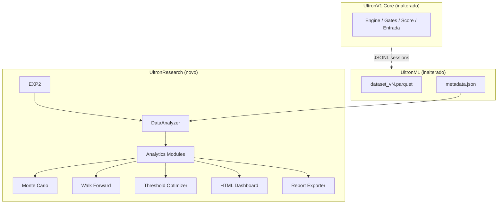

# RC2 — Ultron Research Lab (Fase 2)

**Data:** 2026-06-25  
**Escopo:** Laboratório de pesquisa offline — **sem treinamento ML**, **sem alteração operacional**.

---

## Confirmações explícitas

| Afirmação | Status |
|-----------|--------|
| Nenhuma regra operacional foi alterada | **Confirmado** |
| Nenhum modelo foi treinado | **Confirmado** |
| Comportamento RC1 permanece idêntico | **Confirmado** (Research não toca Core/NT8) |
| Research Lab apenas consome datasets exportados | **Confirmado** (parquet + metadata.json) |
| `DatasetBuilder`, `MLModelLoader`, `DummyProvider` não foram modificados | **Confirmado** |
| `UltronV1.Core` não referencia `UltronResearch` | **Confirmado** |
| `UltronML` não referencia `UltronResearch` | **Confirmado** |

---

## 1. Arquitetura



### Direção de dependências

```
UltronCore     →  (nenhuma dependência de Research ou ML)
UltronML       →  (nenhuma dependência de Research)
UltronResearch →  lê apenas arquivos parquet/JSON exportados
```

---

## 2. Estrutura de diretórios

```
UltronResearch/
├── pyproject.toml
├── README.md
├── docs/
│   └── RC2_RESEARCH_ARCHITECTURE.md
├── tests/
│   ├── conftest.py
│   └── test_research.py
└── ultronresearch/
    ├── config.py
    ├── constants.py
    ├── data/
    │   └── loader.py              # DataAnalyzer
    ├── analytics/
    │   ├── metrics.py             # WR, PF, Expectancy, Sharpe, Sortino, DD
    │   ├── time_analysis.py       # Horários + dias
    │   ├── segment_analysis.py    # Archetype, Score, Tier
    │   ├── gates_analysis.py      # Ranking de gates
    │   ├── features_analysis.py   # Correlação, MI, variância
    │   ├── mfe_mae_analysis.py    # Distribuições MFE/MAE
    │   └── atm_analysis.py        # Comparação ATM
    ├── simulation/
    │   ├── monte_carlo.py
    │   └── walk_forward.py
    ├── optimization/
    │   └── threshold_optimizer.py
    ├── ml_prep/
    │   └── schemas.py             # Placeholders FI, SHAP, model comparison
    ├── benchmark/
    │   └── runner.py
    ├── reports/
    │   └── exporter.py
    ├── dashboard/
    │   └── generator.py
    ├── pipeline/
    │   └── research_pipeline.py
    └── cli/
        └── run_research.py
```

---

## 3. Lista de módulos

| # | Requisito | Módulo |
|---|-----------|--------|
| 1 | Data Analyzer | `data/loader.py` — `DataAnalyzer` |
| 2 | Estatísticas gerais | `analytics/metrics.py` |
| 3 | Horários | `analytics/time_analysis.py` |
| 4 | Dias da semana | `analytics/time_analysis.py` |
| 5 | Archetypes | `analytics/segment_analysis.py` |
| 6 | Score | `analytics/segment_analysis.py` + threshold optimizer |
| 7 | Tier | `analytics/segment_analysis.py` |
| 8 | Gates | `analytics/gates_analysis.py` |
| 9 | Features | `analytics/features_analysis.py` |
| 10 | MFE/MAE | `analytics/mfe_mae_analysis.py` |
| 11 | ATM | `analytics/atm_analysis.py` |
| 12 | Monte Carlo | `simulation/monte_carlo.py` |
| 13 | Walk Forward | `simulation/walk_forward.py` |
| 14 | Threshold Optimizer | `optimization/threshold_optimizer.py` |
| 15 | Dashboard HTML | `dashboard/generator.py` |
| 16 | Relatórios multi-formato | `reports/exporter.py` |
| 17 | Arquitetura separada | Pacote independente |
| 18 | Preparação ML | `ml_prep/schemas.py` (placeholders) |

---

## 4. Pipeline completo

```
1. DataAnalyzer.load()
   ├── dataset_vN.parquet (primário)
   ├── opportunities.parquet + outcomes.parquet (opcional)
   └── metadata.json

2. Analytics
   ├── compute_general_stats()
   ├── analyze_hours() / analyze_days()
   ├── analyze_archetypes() / analyze_tiers() / analyze_score()
   ├── analyze_gates()
   ├── analyze_features()
   ├── analyze_mfe_mae()
   └── analyze_atm()

3. Simulation
   ├── run_monte_carlo(5000 sims)
   └── create_walk_forward_split(60/20/20)

4. Optimization
   └── run_threshold_optimizer() — score, tier, confidence (placeholder)

5. ML Prep (sem treino)
   └── build_ml_prep_bundle() — FI, SHAP, model comparison placeholders

6. Export
   ├── research_results.json
   ├── research_summary.md
   ├── segments_summary.csv
   ├── trades_analyzed.parquet
   ├── benchmarks.json
   └── dashboard/index.html
```

### CLI

```powershell
cd UltronV1\UltronResearch
pip install -e ".[dev]"
ultronresearch --datasets-dir ..\UltronML\datasets --output-dir research_output
```

---

## 5. Métricas calculadas

| Métrica | Campo |
|---------|-------|
| Trades | `trades` |
| Win Rate | `win_rate` |
| Profit Factor | `profit_factor` |
| Expectancy | `expectancy` |
| Average Win / Loss | `average_win`, `average_loss` |
| Average MFE / MAE | `average_mfe`, `average_mae` |
| Recovery Factor | `recovery_factor` |
| Max Drawdown | `max_drawdown_ticks` |
| Sharpe simplificado | `sharpe_simple` |
| Sortino simplificado | `sortino_simple` |
| Payoff | `payoff` |

---

## 6. Dashboard HTML

Seções geradas automaticamente:

- Overview · Performance · Equity · Horários · Dias
- Archetypes · Score · Tiers · Gates · Features
- MFE/MAE · ATM · Monte Carlo · Thresholds

Arquivo: `research_output/dashboard/index.html`

---

## 7. Formatos de exportação

| Formato | Arquivo |
|---------|---------|
| JSON | `reports/research_results.json` |
| Markdown | `reports/research_summary.md` |
| CSV | `reports/segments_summary.csv` |
| Parquet | `reports/trades_analyzed.parquet` |
| HTML | `dashboard/index.html` |

---

## 8. ATM

Comparação automática quando coluna `atm_template`, `atm_profile` ou `atm_*` existir no dataset.

Se ausente, relatório indica que é necessário exportar perfil ATM nas sessões (ex.: ATM-A, ATM-B, ATM-C).

---

## 9. Walk Forward e ML

- Split temporal 60% train / 20% validation / 20% test
- Métricas por split calculadas
- Stage `ml_training: not_implemented` — estrutura pronta, **sem treino**

---

## 10. Threshold Optimizer

Pesquisa offline (não altera Core):

- **Score:** melhor `min_score` por PF e Expectancy
- **Tier:** melhor combinação A+/A/B/C
- **Confidence:** placeholder para ML futuro

---

## 11. Testes

| Suite | Resultado |
|-------|-----------|
| `pytest UltronResearch/tests` | **3 passed** |

---

## 12. Arquivos criados vs modificados

### Criados
- Todo o diretório `UltronResearch/` (32+ arquivos)

### Modificados
- **Nenhum** arquivo em `UltronV1.Core`, `UltronML`, `NinjaTrader`, engine ou paper

---

## 13. Próximos passos (Fase 3 — quando solicitado)

1. Exportar dataset real (~868+ trades) via `ultronml-export`
2. Rodar `ultronresearch` no dataset real
3. Adicionar coluna `atm_profile` nas sessões para comparação ATM
4. Treinar modelo ML offline (UltronML Phase 3)
5. Integrar filtro de confidence no host NT8

---

*RC2 Fase 2 — Research Lab concluída. O Ultron continua operando exatamente como RC1.*
