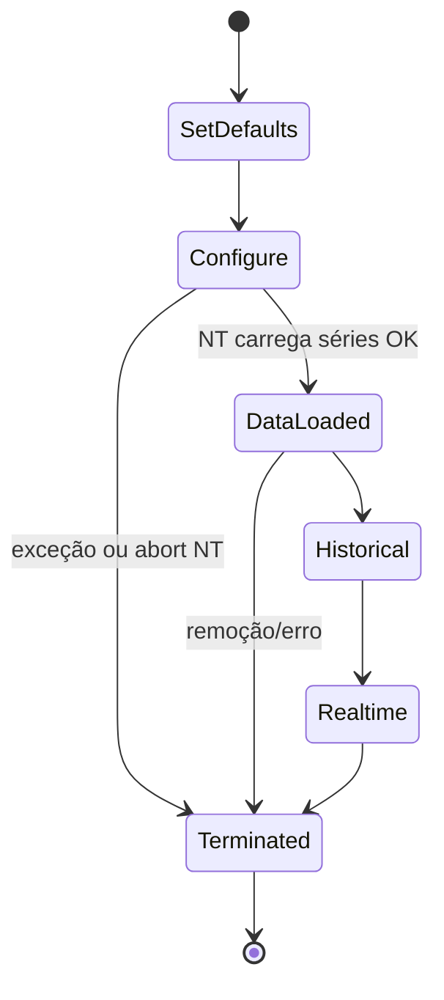

# STATE_MACHINE_AUDIT — UltronV1Paper.OnStateChange()

**Data:** 2026-06-26  
**Escopo:** Auditoria **exclusiva** de `OnStateChange()` em `UltronV1Paper`  
**Código alterado:** Nenhum  
**Arquivo auditado:** `UltronV1/NinjaTrader/UltronV1Paper.cs` (linhas 109–321)  
**Objetivo:** Explicar por que o NinjaTrader pode terminar a strategy logo após `State.Configure` (caminho `SetDefaults → Configure → Terminated` sem `DataLoaded`).

---

## 1. Resumo executivo

| Pergunta | Resultado |
|----------|-----------|
| `AddDataSeries` em `UltronV1Paper` == `UltronV1`? | **Sim — chamada idêntica** |
| Há código em `Configure` que impeça `DataLoaded`? | **Não** — nenhum `return`, `Disable()`, `Close()` ou branch condicional |
| Há chamadas proibidas em `Configure`? | **Não** — apenas `Print` + `AddDataSeries` |
| Propriedades RC2 usadas antes de `DataLoaded`? | **Não** — só **atribuídas** em `SetDefaults`; **lidas** apenas em `DataLoaded`+ |
| `OnStateChange` contém caminho que termina a strategy? | **Não explicitamente** — apenas `throw` em `catch` (re-lança exceção) e `Dispose` em `Terminated` |
| `SetDefaults → Configure → Terminated` é compatível com `AddDataSeries` incorreto? | **Parcialmente** — exceção em `AddDataSeries` sim; mas a chamada é **igual** à do indicador que funciona |
| Causa mais provável se `DataLoaded` nunca aparece | **(A)** exceção em `Configure`/`AddDataSeries`, **(B)** falha NT ao carregar barras entre `Configure` e `DataLoaded`, **(C)** strategy removida/desabilitada externamente |

---

## 2. Máquina de estados — visão geral



**Observação NT8:** O código da strategy **não controla** a transição `Configure → DataLoaded`. O NinjaTrader carrega as séries de dados **entre** esses dois estados. Se o carregamento falha ou a strategy é abortada, o NT pode ir direto para `Terminated` **sem** invocar o bloco `DataLoaded`.

---

## 3. Inventário de `AddDataSeries()`

### 3.1 UltronV1Paper (`State.Configure`, linha 167)

| Campo | Valor |
|-------|-------|
| **Instrumento** | *Implícito* — mesma série primária do gráfico (`Instrument` do chart). **Não** há overload com `string instrument`. |
| **BarsPeriodType** | `BarsPeriodType.Minute` |
| **Valor (period)** | `MnqContractSpec.MtfBarPeriodMinutes` = **15** |
| **Overload NT8** | `AddDataSeries(BarsPeriodType periodType, int period)` — **2 parâmetros**, sem `BarsPeriod`, sem `TradingHours`, sem instrumento explícito |
| **Índice resultante** | `BarsInProgress == 1` / `BarsArray[1]` / `CurrentBars[1]` (série secundária MTF) |
| **Série primária** | Definida pelo **gráfico** (tipo/período do chart), não por `OnStateChange` |

### 3.2 UltronV1 Indicator (`State.Configure`, linha 62)

```csharp
AddDataSeries(BarsPeriodType.Minute, MnqContractSpec.MtfBarPeriodMinutes);
```

| Comparação | UltronV1Paper | UltronV1 |
|------------|---------------|----------|
| Chamada | Idêntica | Idêntica |
| Constante MTF | `15` minutos | `15` minutos |
| Instrumento | Implícito (chart) | Implícito (chart) |
| Quantidade de séries adicionadas | **1** | **1** |

**Veredito:** Ambos adicionam **exatamente a mesma** série secundária MTF de 15 minutos no instrumento do gráfico.

### 3.3 Implicações para o gráfico

Documentação do projeto (`Fase5-OutcomeCollection.md`) recomenda chart **MNQ 09-26 5m**. A strategy **não valida** período primário em `Configure` — validação de contrato ocorre só em `DataLoaded` (`_engine.IsContractValid`).

| Chart primário | Comportamento esperado |
|----------------|------------------------|
| MNQ 09-26 **5 min** | Primário 5m + secundário 15m — padrão de design |
| MNQ 09-26 **15 min** | Primário 15m + secundário 15m (mesmo tipo/valor) — NT geralmente aceita, mas é configuração não documentada |
| Instrumento **não-MNQ** | `Configure` **ainda executa**; falha operacional só em `DataLoaded` (log `INVALID CONTRACT`) |
| Série inválida / sem dados | Pode impedir `DataLoaded` ou deixar strategy inativa — **fora** do código `OnStateChange` |

---

## 4. Análise por estado

### 4.1 `State.SetDefaults` (linhas 111–160)

**Operações:**
- Atribuição de propriedades padrão NT8 (`Calculate`, `BarsRequiredToTrade`, `RealtimeErrorHandling`, etc.)
- Defaults Ultron Paper (SL/TP, tier, pipeline/telemetry)
- Defaults RC2 ML (todos **desligados** por padrão)
- Defaults Execution (`PaperBarSim`, `Sim101`, ATM vazio)

**Propriedades RC2 atribuídas aqui (não lidas):**

| Propriedade | Default |
|-------------|---------|
| `EnableShadowMl` | `false` |
| `ShadowMlModelDirectory` | `string.Empty` |
| `MlFilterMode` | `Disabled` |
| `EnableMlFilter` | `false` |
| `ForcePassThrough` | `false` |
| `MlUseAutoThreshold` | `true` |
| `MlThresholdManual` | `0.70` |

**Chamadas proibidas:** Nenhuma (sem Account, ATM, IO, ML, ordens).

**Caminhos de saída:** `catch` → `Print("[INIT ERROR]")` → `throw` (telemetria temporária).

---

### 4.2 `State.Configure` (linhas 162–174)

**Código efetivo (operacional):**

```csharp
AddDataSeries(BarsPeriodType.Minute, MnqContractSpec.MtfBarPeriodMinutes);
```

**Também presente (somente telemetria temporária):** `Print("[INIT] Entrou/Depois de State.Configure")`.

#### Checklist de chamadas proibidas em `Configure`

| Categoria | Presente em `Configure`? |
|-----------|--------------------------|
| `CreateOrder` / ordens | **Não** |
| `Account` / `Account.All` | **Não** |
| ATM (`StartAtmStrategy`) | **Não** |
| Model Load (`UltronMlHost`, ONNX) | **Não** |
| DLL Load (`Assembly.Load`) | **Não** |
| IO (`File`, `Directory`, `Path.Combine`) | **Não** |
| Reflection | **Não** |
| `InitializeMlHost` | **Não** |
| `InitDiagValidateAtm` | **Não** |
| Engine / Dataset / TradeCycle | **Não** |

**Veredito:** `Configure` está **limpo** relativamente às restrições NT8. Única operação com efeito estrutural é `AddDataSeries`.

**Caminhos de saída:**
- `catch` → `throw` (se `AddDataSeries` ou `Print` falhar)
- **Sem** `return` antecipado

---

### 4.3 Transição `Configure → DataLoaded`

#### Existe condição **no código** que impeça `DataLoaded`?

**Não.** Não há:
- `if` que pule estados
- `return` em `Configure`
- `Disable()` / `Close()` / `Environment.Exit()`
- Flag customizada bloqueando avanço

O bloco `else if (State == State.DataLoaded)` será executado **se e somente se** o NT emitir esse estado.

#### O que pode impedir `DataLoaded` (plataforma / ambiente)

| Causa | Sintoma típico no Output |
|-------|---------------------------|
| Exceção em `AddDataSeries` | `[INIT ERROR] State.Configure: ...` (com telemetria) |
| Falha ao subscrever/carregar série secundária | `Depois de State.Configure` **sem** `Entrou em State.DataLoaded` |
| Strategy removida/desabilitada pelo usuário | `Entrou em State.Terminated` |
| Erro de compilação / assembly ML ausente | Strategy nem instancia corretamente |
| Chart sem barras / instrumento inválido para dados | `DataLoaded` atrasado ou strategy desabilitada |

---

### 4.4 `State.DataLoaded` (linhas 176–276)

**Ordem de execução (operacional):**

1. `_logger = new UltronNtLogger(Print)`
2. `InitDiagLogConfigSnapshot()` — **telemetria** (lê props RC2/Execution)
3. `DatasetEngine` + `UltronConfig`
4. `TradeCycleTracker`
5. `UltronEngine` + `Initialize(Instrument.FullName)`
6. `_indicators.Create(this)`
7. Pipeline diagnostics (IO — condicional)
8. Execution telemetry (IO — condicional)
9. `LogPaperExecutionMode()`
10. `InitDiagValidateAtm()` — **telemetria** (Account, File.Exists ATM)
11. `InitializeMlHost()` — ML/ONNX (condicional; default **skip**)
12. Log de sessão

**Propriedades RC2 lidas aqui (não em Configure):**

| Propriedade | Onde |
|-------------|------|
| `EnableShadowMl`, `MlFilterMode`, `EnableMlFilter`, etc. | `InitDiagLogConfigSnapshot`, `InitializeMlHost` |
| `ShadowMlModelDirectory` | `InitializeMlHost` → `ResolveShadowModelDirectory` |
| `ExecutionMode`, `AccountName`, `AtmTemplateName` | `InitDiagLogConfigSnapshot`, `InitDiagValidateAtm`, `LogPaperExecutionMode` |

**Chamadas com risco de exceção (só em `DataLoaded`, não em `Configure`):**

| Chamada | Risco |
|---------|-------|
| `Path.Combine` + `DatasetEngine` | IO / permissão |
| `_indicators.Create(this)` | Indicadores NT |
| `_engine.Initialize(Instrument.FullName)` | Contrato inválido (não lança — só `IsContractValid=false`) |
| `InitDiagValidateAtm` | `Account.All`, `File.Exists` |
| `InitializeMlHost` | `Assembly.Load`, ONNX, `UltronMlHost` — **só se ML habilitado** |
| `InitDiagProbeOnnxDll` | Reflection — **só se ML habilitado** |

**Com defaults RC2 (`EnableShadowMl=false`, `MlFilterMode=Disabled`):** `InitializeMlHost` retorna imediatamente — **comportamento RC1-equivalente** nesta fase.

---

### 4.5 `State.Historical` / `State.Realtime` (linhas 278–284)

Apenas `Print` de telemetria. **Sem** lógica operacional.  
**RC1:** esses blocos **não existiam**.

---

### 4.6 `State.Terminated` (linhas 286–319)

**Operações:**
- Fechar logs pipeline/telemetry
- `_mlHost?.Dispose()`
- `_engine?.Shutdown()`
- Nullificar referências

**Não contém:** `Disable()`, `Close()`, `Environment.Exit()`.

`Dispose` aparece **apenas** aqui, no cleanup — não é causa de término precoce.

---

## 5. Varredura de caminhos de término em `OnStateChange`

| Padrão | Ocorrências em `OnStateChange` |
|--------|-------------------------------|
| `return;` | **0** |
| `throw;` | 8× (todos em blocos `catch` de telemetria — re-lançam) |
| `try/catch` | 6 blocos (telemetria temporária) |
| `Disable()` | **0** |
| `Close()` | **0** |
| `Dispose()` | 1× (`_mlHost?.Dispose()` em `Terminated` apenas) |
| `Environment.Exit()` | **0** |

**Conclusão:** O método **não** desabilita a strategy programaticamente. Término precoce implica **exceção não tratada fora dos catches** ou **ação da plataforma NT** entre estados.

---

## 6. Diff RC1 vs RC2 — `OnStateChange()` apenas

**Baseline RC1:** versão pré-Fase 4A/4B (sem ML, sem telemetria `[INIT]`), reconstruída a partir de `Fase5-OutcomeCollection.md`, `RC2_PHASE4_SHADOW_REPORT.md` e estrutura atual sem os blocos RC2/diag.

### 6.1 `SetDefaults`

```diff
  RC1                                    RC2 (atual)
  ───                                    ───────────
  PaperStopLossTicks, etc.               (igual)
  ExecutionMode, AccountName,            (igual — migração ATM pré-RC2)
  AtmTemplateName, Quantity              (igual)
  EnablePipelineDiagnostics, etc.        (igual)
+                                         Print("[INIT] Entrou/Depois SetDefaults")
+                                         try/catch telemetria
-                                         (fim SetDefaults)
+ EnableShadowMl = false                 NOVO RC2
+ ShadowMlModelDirectory = ""            NOVO RC2
+ MlFilterMode = Disabled                NOVO RC2
+ EnableMlFilter = false                 NOVO RC2
+ ForcePassThrough = false               NOVO RC2
+ MlUseAutoThreshold = true              NOVO RC2
+ MlThresholdManual = 0.70               NOVO RC2
```

### 6.2 `Configure`

```diff
  RC1                                    RC2 (atual)
  ───                                    ───────────
  AddDataSeries(Minute, 15)              AddDataSeries(Minute, 15)   ← IDÊNTICO
+                                         Print + try/catch telemetria
```

### 6.3 `DataLoaded`

```diff
  RC1                                    RC2 (atual)
  ───                                    ───────────
  _logger, cfg, dataset                  (igual — ordem preservada)
  tradeCycle, engine, indicators         (igual)
  pipeline diag, execution telemetry     (igual)
  LogPaperExecutionMode()                (igual)
-                                         (fim)
+ InitDiagLogConfigSnapshot()            TELEMETRIA (lê props RC2)
+ InitDiagValidateAtm()                  TELEMETRIA (Account, ATM file)
+ InitializeMlHost(root)                 NOVO RC2 (no-op com defaults)
+ blocos try/catch por etapa             TELEMETRIA
```

### 6.4 Estados adicionais RC2

```diff
+ else if (State == State.Historical) { Print(...) }
+ else if (State == State.Realtime)   { Print(...) }
```

### 6.5 `Terminated`

```diff
  RC1                                    RC2 (atual)
  ───                                    ───────────
  pipeline/telemetry close               (igual)
  engine shutdown                        (igual)
-                                         (fim)
+ _mlHost?.Dispose()                     NOVO RC2
+ Print telemetria Terminated            TELEMETRIA
```

### 6.6 Veredito do diff

| Área | Mudança operacional em `Configure`? |
|------|-----------------------------------|
| `AddDataSeries` | **Nenhuma** |
| Props RC2 | Apenas defaults em `SetDefaults` |
| ML | Só em `DataLoaded`; **inativo** com defaults |
| Telemetria | Prints + try/catch — não altera fluxo exceto se `throw` |

**RC2 com defaults == RC1 em `Configure`** do ponto de vista operacional.

---

## 7. Compatibilidade: `SetDefaults → Configure → Terminated`

### 7.1 Cenário observado

```
[INIT] Entrou em State.SetDefaults
[INIT] Depois de State.SetDefaults
[INIT] Entrou em State.Configure
[INIT] Depois de State.Configure
[INIT] Entrou em State.Terminated        ← sem DataLoaded
```

### 7.2 Compatibilidade com `AddDataSeries` incorreto

| Hipótese | Compatível? | Evidência neste código |
|----------|-------------|------------------------|
| `AddDataSeries` com parâmetros errados vs UltronV1 | **Improvável** | Chamada **byte-a-byte igual** ao indicador |
| `AddDataSeries` lança exceção | **Sim** | Única op. estrutural em `Configure`; veria `[INIT ERROR] State.Configure` |
| Período primário do chart incompatível com MTF 15m | **Possível** (NT) | Não validado em código; depende do chart |
| Instrumento sem dados para série 15m | **Possível** (NT) | Falha **entre** estados, sem log em `OnStateChange` |

### 7.3 Compatibilidade com falha de inicialização das Bars

| Hipótese | Compatível? |
|----------|-------------|
| NT não consegue construir `BarsArray[1]` após `Configure` | **Sim** — padrão clássico para pular `DataLoaded` |
| Falha em `DataLoaded` (ex.: ML, dataset) | **Não** para este cenário — `Terminated` viria **depois** de `Entrou em State.DataLoaded` |
| `IsContractValid == false` | **Não** causa `Terminated` — só log; strategy permanece habilitada |

### 7.4 Diagnóstico diferencial (com telemetria `[INIT]` ativa)

| Última linha `[INIT]` | Interpretação |
|----------------------|---------------|
| `Entrou em State.Configure` (sem `Depois`) | Exceção **dentro** de `AddDataSeries` |
| `Depois de State.Configure` (sem `DataLoaded`) | **Falha NT** no carregamento de barras ou remoção externa |
| `Entrou em State.DataLoaded` + `[INIT ERROR]` | Falha em init pós-Configure — **não** é o cenário Configure→Terminated |
| `Depois de State.DataLoaded` + checkbox off | Desabilitação **após** init completo (outra causa) |

---

## 8. Conclusão

### 8.1 Sobre `OnStateChange` especificamente

1. **`Configure` não contém** nenhuma operação proibida nem uso de propriedades RC2/ML/ATM/Account.
2. **`AddDataSeries` é idêntico** entre `UltronV1Paper` e `UltronV1` — não há divergência de séries.
3. **Não há** `return`, `Disable()`, `Close()` ou lógica que encerre a strategy dentro de `OnStateChange`.
4. Propriedades RC2 são **definidas** em `SetDefaults` e **consumidas** apenas a partir de `DataLoaded` (com defaults que tornam ML no-op).

### 8.2 Sobre `SetDefaults → Configure → Terminated`

Este padrão **não é explicado** por:
- diferença de `AddDataSeries` em relação ao UltronV1;
- uso de Shadow ML / ONNX / ATM em `Configure`;
- código RC2 em `OnStateChange` antes de `DataLoaded`.

É **consistente com**:
- exceção em `AddDataSeries` (investigar `[INIT ERROR] State.Configure`);
- **falha da plataforma** ao materializar a série secundária 15m após `Configure`;
- remoção/desabilitação manual ou erro externo ao script.

### 8.3 Próximo passo de investigação (sem alterar código operacional)

1. Confirmar no Output se aparece `Depois de State.Configure` **sem** `Entrou em State.DataLoaded`.
2. Testar no **mesmo gráfico** onde `UltronV1` (indicador) funciona: MNQ 09-26, 5 minutos.
3. Verificar aba **Log** do NT por erros de dados/série não capturados por `Print`.
4. Se `DataLoaded` ocorrer mas checkbox cair depois, a causa **não está** em `Configure` — rever `DataLoaded` / `RealtimeErrorHandling` / erros de ordem fora deste audit.

---

*Nenhuma correção implementada — auditoria estática somente leitura.*
